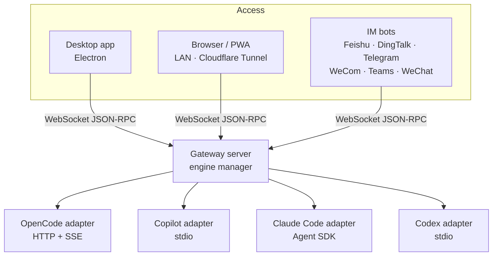

# CodeMux

**Claude Code、Copilot CLI、OpenCode、Codex をひとつのワークベンチで。デスクトップでも、どのブラウザからでも、チャットアプリからでも。**

[English](./README.md) | [简体中文](./README.zh-CN.md) | **日本語** | [한국어](./README.ko.md) | [Русский](./README.ru.md)

[ウェブサイト](https://realduang.github.io/codemux/) · [ダウンロード](https://github.com/realDuang/codemux/releases/latest) · [ドキュメント](#-ドキュメント) · [ロードマップ](https://github.com/realDuang/codemux/discussions/61)

## CodeMux とは？

CodeMux は**コーディングエージェント**のためのオープンソースのデスクトップ／Web クライアントです。モデル API をラップするのではなく、各エージェント自身のランタイムとプロトコルレベルで通信します。そのため Claude Code、GitHub Copilot CLI、OpenCode、Codex はそれぞれのツール、セッション、プロジェクトコンテキストを保ったまま動作し、あなたはそのすべてをひとつのインターフェースから使えます。

さらに、**席を離れても作業を続けられます**。ツール呼び出し、差分、シェルコマンドがリアルタイムに描画される同じセッションに、スマートフォンのブラウザや、Feishu、DingTalk、Telegram、WeCom、Teams、WeChat からアクセスできます。ポート転送は不要です。

- 🔀 **マルチモデルではなくマルチエンジン**：4 つの本物のエージェントランタイムをひとつの UI で、セッションごとに切り替え可能。
- 👀 **思考の連鎖をすべて見える化**：ツール呼び出し、ファイル差分、コマンドはすべて展開できるステップとして表示され、テキストの壁にはなりません。
- 📱 **標準でリモート対応**：LAN の QR コード、またはワンクリックの Cloudflare Tunnel。デバイス承認とデバイスごとのトークン付き。
- 💬 **チャットアプリからエージェントを操作**：6 つの IM プラットフォームでストリーミングの構造化された返信。
- 🧰 **本格的なワークベンチ**：統合ターミナル、ファイルエクスプローラー、git worktree、スケジュールタスク、スラッシュコマンドとスキル。

> 💡 CodeMux は **GitHub Copilot CLI 初のオープンソース GUI** です。JSON-RPC で接続し、Copilot のエージェント体験をそのままビジュアルに提供します。

## 🚀 インストール

| プラットフォーム | 入手方法 |
|----------|--------|
| **macOS** | `brew tap realDuang/codemux && brew install --cask codemux`、または [Releases](https://github.com/realDuang/codemux/releases/latest) の `.dmg`（Apple Silicon は `-arm64.dmg`） |
| **Windows** | [Releases](https://github.com/realDuang/codemux/releases/latest) の `CodeMux-Setup-<version>.exe` |
| **Linux デスクトップ** | [Releases](https://github.com/realDuang/codemux/releases/latest) の `.AppImage` または `.deb` |
| **Linux サーバー（ヘッドレス）** | Node ホストを起動し、任意のブラウザから利用。[Server runtime](docs/server-runtime.md) を参照 |
| **ソースから** | [Development](docs/development.md) を参照 |

> ⚠️ macOS 版はコード署名されていません。「アプリが壊れています」と表示された場合は `xattr -cr /Applications/CodeMux.app` を実行してください。

### エンジンを接続する

CodeMux は起動時にインストール済みのエンジンを検出します。少なくとも 1 つが必要です。

| エンジン | プロトコル | ステータス | セットアップ |
|--------|----------|--------|-------|
| **[Claude Code](https://docs.anthropic.com/en/docs/claude-code)** | Claude Agent SDK | ✅ 安定版 | ランタイム同梱。既存の Claude Code ログインまたは `ANTHROPIC_API_KEY` を使用。 |
| **[GitHub Copilot CLI](https://docs.github.com/en/copilot/concepts/agents/about-copilot-cli)** | JSON-RPC / stdio | ✅ 安定版 | Copilot CLI をインストールしてサインイン。 |
| **[OpenCode](https://opencode.ai)** | HTTP REST + SSE | ✅ 安定版 | `curl -fsSL https://opencode.ai/install \| bash`（Windows：`irm https://opencode.ai/install.ps1 \| iex`） |
| **[Codex](https://github.com/openai/codex)** | JSON-RPC / stdio app-server | ⚠️ 実験的 | `codex` CLI をインストール。ログインまたは API キーをそのまま再利用。 |

### スマートフォンから開く

1. CodeMux で **Remote connections** を開きます。**Access this computer from another device** で、LAN 経由なら **Direct connection**、どこからでもアクセスするなら **Cloudflare Tunnel** を選びます（クイックトンネルはアカウント不要）。
2. Direct connection の場合は、このコンピューターの LAN アドレス（例：`http://192.168.1.20:8233`）を入力し、**Enable direct access** を選びます。Cloudflare Tunnel の場合は、トンネルを有効にします。ページに表示される QR コードをスキャンします。
3. スマートフォンでホストの 6 桁のアクセスコードを入力し、ホスト側で新しいデバイスを承認します。

## ✨ 機能

### エージェントの思考の連鎖を描画

エージェントのあらゆる操作が展開できるステップになります。シンタックスハイライト付きのファイル差分、ライブ出力付きのシェルコマンド、検索、ツール呼び出し、Todo リスト、権限の確認。最終的な答えだけでなく、エージェントが何をなぜしているのかが分かり、同じ表示がブラウザや IM でも使えます。

### チャット欄ではなく、ワークベンチ

| | |
|---|---|
| **統合ターミナル** | VS Code 風のタブで本物のシェル（`` Ctrl+` ``）。検索、クリック可能なパス、LAN やトンネル越しのリモート利用に対応。 |
| **ファイルエクスプローラーと git 変更** | プロジェクトツリー、シンタックスハイライト付きプレビュー、行数とインライン差分を表示するリアルタイムの「Changes」タブ。 |
| **Git worktree セッション** | 複数のブランチを並行して作業し、それぞれに独自のセッション。merge、squash、rebase で取り込み。 |
| **スケジュールタスク** | 手動、5 分〜12 時間ごと、毎日または毎週エージェントタスクを実行。実行漏れも後から補完。 |
| **スラッシュコマンドとスキル** | `/` を入力するとエンジン固有のコマンドとスキルを補完付きで呼び出し。 |
| **エージェントモードとモデル** | Build / Plan / Autopilot モード、エンジンごとに個別のモデル。 |
| **承認と質問** | シェルや編集操作をインラインで承認（信頼できるパターンは「常に許可」）。エージェントの選択式の質問に回答。 |
| **プロンプトに画像** | 貼り付け、ドラッグ、選択で 1 メッセージ最大 4 枚。すべてのエンジンが読み取れます。 |
| **トークン使用量** | 入力・出力・キャッシュのトークン数と、エンジン別のコスト内訳。 |

<table>
  <tr>
    <td></td>
    <td></td>
  </tr>
  <tr>
    <td align="center">統合ターミナル</td>
    <td align="center">インライン差分付きの git 変更</td>
  </tr>
  <tr>
    <td></td>
    <td></td>
  </tr>
  <tr>
    <td align="center">スケジュールタスク</td>
    <td align="center">ファイルエクスプローラーとプレビュー</td>
  </tr>
</table>

### 体験をそのまま保つリモートアクセス

| 方法 | 適した用途 |
|--------|----------|
| **LAN ブラウザ** | 同じネットワーク上の別デバイス。このコンピューターの LAN IP と Web ポートで Direct connection を有効にし、QR コードをスキャン。 |
| **Cloudflare Tunnel** | ポート転送や VPN なしでどこからでも。クイックトンネルは設定不要、名前付きトンネルなら[独自ドメイン](docs/custom-access.md#cloudflare-custom-domains)を維持。 |
| **Direct connection** | 独自のリバースプロキシやルート。[Custom access](docs/custom-access.md) を参照。 |
| **Remote SSH** | システムの OpenSSH を使い、CodeMux Desktop から稼働中の既存の CodeMux ホストに接続。[Remote connections](docs/remote-hosts.md) を参照。 |
| **インストール可能な PWA** | 安定した HTTPS アドレスでスマートフォンのホーム画面に追加。[Web and mobile PWA](docs/web-pwa.md) を参照。 |

新しいデバイスは 6 桁のコードで承認が必要で、デバイスごとに個別の JWT が発行され、公開トンネルは HTTPS を使用します。デバイス管理ページから任意のデバイスの名前変更や取り消しができます。

<table>
  <tr>
    <td></td>
    <td></td>
    <td width="22%"></td>
  </tr>
  <tr>
    <td align="center">リモートアクセス</td>
    <td align="center">デバイス管理</td>
    <td align="center">スマートフォンで同じセッション</td>
  </tr>
</table>

> CodeMux は個人利用を想定しています。使わなくなったデバイスは取り消し、不要なときは公開トンネルをオフにしてください。

### チャットアプリの中のコーディングエージェント

IM からエージェントと会話でき、プレーンテキストだけでなくストリーミング出力と構造化カードで返信を受け取れます。ボットとの個人チャットでプロジェクトとセッションを選び、`/cancel`、`/status`、`/mode`、`/model`、`/history`、`/help` を使えます。

| プラットフォーム | ストリーミング | セッションモデル | リッチコンテンツ |
|----------|-----------|---------------|--------------|
| [Feishu / Lark](docs/channels/feishu/README.md) | ✅ その場で更新 | 1 グループ = 1 セッション | インタラクティブカード |
| [DingTalk](docs/channels/dingtalk/README.md) | ✅ AI カード | 1 グループ = 1 セッション | ActionCard / Markdown |
| [Telegram](docs/channels/telegram/README.md) | ✅ 下書き / 編集 | 個人チャット | MarkdownV2 + ボタン |
| [WeCom](docs/channels/wecom/README.md) | 一括送信 | 1 グループ = 1 セッション | Markdown / テンプレートカード |
| [Microsoft Teams](docs/channels/teams/README.md) | ✅ その場で更新 | 個人チャット | Adaptive Cards |
| [WeChat（iLink、個人アカウント）](docs/channels/weixin-ilink/README.md) | 一括送信 | 個人チャット | プレーンテキスト |

📖 [チャネル設定ガイド](docs/channels/README.md)

## 何が違うのか？

| | CodeMux | テキストのみのチャットボット | 単一エージェント専用の UI |
|---|---|---|---|
| 本物のエージェントランタイム（ツール、セッション、プロジェクトコンテキスト） | ✅ | ⚠️ 多くはモデル API | ✅ |
| 複数のエージェントを一か所で | ✅ Claude Code、Copilot、OpenCode、Codex | ❌ | ❌ |
| ツール呼び出し、差分、シェル出力をステップとして描画 | ✅ | ❌ 最終テキストのみ | ✅ ローカルのみ |
| スマートフォンのブラウザと IM でも同じ体験 | ✅ | ⚠️ テキストのみ | ❌ |
| セルフホスト、自分のマシン、自分の認証情報 | ✅ | 場合による | ✅ |

## アーキテクチャ

すべてのクライアントは同じゲートウェイを通じて接続し、各エンジンはひとつの**正規化された型システム**に変換されます。そのため、どのエンジンやクライアントを使っても、ツール呼び出し、差分、ストリーミングメッセージは同じように表示されます。

## 📚 ドキュメント

| トピック | ドキュメント |
|-------|-----|
| IM チャネルの設定 | [docs/channels](docs/channels/README.md) |
| カスタムドメインとアクセス | [docs/custom-access.md](docs/custom-access.md) |
| Web とモバイル PWA | [docs/web-pwa.md](docs/web-pwa.md) |
| ヘッドレス Linux サーバー | [docs/server-runtime.md](docs/server-runtime.md) |
| Codex Desktop とのチャット共有 | [docs/codex-desktop-sharing.md](docs/codex-desktop-sharing.md) |
| 開発、コマンド、分離された開発環境 | [docs/development.md](docs/development.md) |
| プロジェクト構成 | [docs/project-structure.md](docs/project-structure.md) |

ドキュメントは英語で書かれています。

## 🤝 コントリビューション

Issue、アイデア、プルリクエストを歓迎します。まず [CONTRIBUTING.md](CONTRIBUTING.md) を読み、[ロードマップ](https://github.com/realDuang/codemux/discussions/61)を確認し、質問は [Discussions](https://github.com/realDuang/codemux/discussions) へどうぞ。別のエンジンを追加したい場合は [Adding a new engine](docs/development.md#adding-a-new-engine) を参照してください。

CodeMux が役に立ったら、⭐ をいただけると他の人が見つけやすくなります。

## ライセンス

[MIT](LICENSE)

**[Electron](https://electronjs.org)、[SolidJS](https://solidjs.com)、そして AI 支援コーディングへの愛で作られています。**

