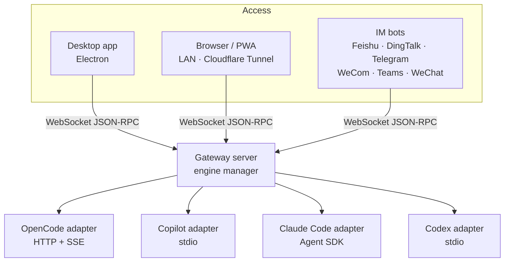

# CodeMux

**Claude Code, Copilot CLI, OpenCode, Codex를 하나의 워크벤치에서. 데스크톱에서, 어떤 브라우저에서든, 채팅 앱에서도.**

[English](./README.md) | [简体中文](./README.zh-CN.md) | [日本語](./README.ja.md) | **한국어** | [Русский](./README.ru.md)

[웹사이트](https://realduang.github.io/codemux/) · [다운로드](https://github.com/realDuang/codemux/releases/latest) · [문서](#-문서) · [로드맵](https://github.com/realDuang/codemux/discussions/61)

## CodeMux란?

CodeMux는 **코딩 에이전트**를 위한 오픈소스 데스크톱 및 웹 클라이언트입니다. 모델 API를 감싸는 것이 아니라 각 에이전트의 자체 런타임과 프로토콜 수준에서 통신합니다. 그래서 Claude Code, GitHub Copilot CLI, OpenCode, Codex는 각자의 도구, 세션, 프로젝트 컨텍스트를 그대로 유지하고, 여러분은 그 모두를 하나의 인터페이스에서 사용할 수 있습니다.

그리고 **자리를 떠나서도** 작업을 이어갈 수 있습니다. 모든 도구 호출, diff, 셸 명령이 실시간으로 렌더링되는 같은 세션에 휴대폰 브라우저나 Feishu, DingTalk, Telegram, WeCom, Teams, WeChat에서 접속할 수 있으며, 포트 포워딩이 필요 없습니다.

- 🔀 **멀티 모델이 아닌 멀티 엔진**: 네 개의 실제 에이전트 런타임을 하나의 UI에서, 세션마다 전환 가능.
- 👀 **사고의 흐름 전체를 확인**: 모든 도구 호출, 파일 diff, 명령이 펼칠 수 있는 단계로 표시되며, 텍스트 덩어리로 뭉개지지 않습니다.
- 📱 **기본으로 원격 지원**: LAN QR 코드 또는 원클릭 Cloudflare Tunnel, 기기 승인과 기기별 토큰 포함.
- 💬 **채팅 앱 속 에이전트**: 6개 IM 플랫폼에서 스트리밍되는 구조화된 응답.
- 🧰 **진짜 워크벤치**: 통합 터미널, 파일 탐색기, git worktree, 예약 작업, 슬래시 명령과 스킬.

> 💡 CodeMux는 **GitHub Copilot CLI 최초의 오픈소스 GUI**입니다. JSON-RPC로 연결해 Copilot의 에이전트 경험을 시각적으로 그대로 제공합니다.

## 🚀 설치

| 플랫폼 | 받는 방법 |
|----------|--------|
| **macOS** | `brew tap realDuang/codemux && brew install --cask codemux`, 또는 [Releases](https://github.com/realDuang/codemux/releases/latest)의 `.dmg` (Apple Silicon: `-arm64.dmg`) |
| **Windows** | [Releases](https://github.com/realDuang/codemux/releases/latest)의 `CodeMux-Setup-<version>.exe` |
| **Linux 데스크톱** | [Releases](https://github.com/realDuang/codemux/releases/latest)의 `.AppImage` 또는 `.deb` |
| **Linux 서버 (헤드리스)** | Node 호스트를 실행하고 아무 브라우저에서 사용. [Server runtime](docs/server-runtime.md) 참고 |
| **소스에서 빌드** | [Development](docs/development.md) 참고 |

> ⚠️ macOS 빌드는 코드 서명되지 않았습니다. "앱이 손상되었습니다"라는 메시지가 나오면 `xattr -cr /Applications/CodeMux.app`을 실행하세요.

### 엔진 연결하기

CodeMux는 시작할 때 설치된 엔진을 감지합니다. 최소 하나가 필요합니다.

| 엔진 | 프로토콜 | 상태 | 설정 |
|--------|----------|--------|-------|
| **[Claude Code](https://docs.anthropic.com/en/docs/claude-code)** | Claude Agent SDK | ✅ 안정 | 런타임 내장. 기존 Claude Code 로그인 또는 `ANTHROPIC_API_KEY` 사용. |
| **[GitHub Copilot CLI](https://docs.github.com/en/copilot/concepts/agents/about-copilot-cli)** | JSON-RPC / stdio | ✅ 안정 | Copilot CLI를 설치하고 로그인. |
| **[OpenCode](https://opencode.ai)** | HTTP REST + SSE | ✅ 안정 | `curl -fsSL https://opencode.ai/install \| bash` (Windows: `irm https://opencode.ai/install.ps1 \| iex`) |
| **[Codex](https://github.com/openai/codex)** | JSON-RPC / stdio app-server | ⚠️ 실험적 | `codex` CLI 설치. 기존 로그인 또는 API 키를 재사용. |

### 휴대폰에서 열기

1. CodeMux에서 **Remote connections**를 엽니다. **Access this computer from another device**에서 LAN 접속은 **Direct connection**, 어디서나 접속하려면 **Cloudflare Tunnel**을 선택합니다(퀵 터널은 계정 불필요).
2. Direct connection은 이 컴퓨터의 LAN 주소(예: `http://192.168.1.20:8233`)를 입력하고 **Enable direct access**를 선택합니다. Cloudflare Tunnel은 터널을 켭니다. 페이지에 표시된 QR 코드를 스캔합니다.
3. 휴대폰에서 호스트의 6자리 액세스 코드를 입력한 뒤, 호스트에서 새 기기를 승인합니다.

## ✨ 기능

### 에이전트의 사고 흐름을 렌더링

에이전트의 모든 동작이 펼칠 수 있는 단계가 됩니다. 구문 강조된 파일 diff, 실시간 출력이 보이는 셸 명령, 검색, 도구 호출, 할 일 목록, 권한 요청까지. 최종 답만이 아니라 에이전트가 무엇을 왜 하는지 볼 수 있고, 같은 화면이 브라우저와 IM에서도 이어집니다.

### 채팅창이 아닌 워크벤치

| | |
|---|---|
| **통합 터미널** | VS Code 스타일 탭의 실제 셸 (`` Ctrl+` ``), 검색, 클릭 가능한 경로, LAN이나 터널을 통한 원격 사용. |
| **파일 탐색기와 git 변경 사항** | 프로젝트 트리, 구문 강조 미리보기, 줄 수와 인라인 diff를 보여 주는 실시간 "Changes" 탭. |
| **Git worktree 세션** | 여러 브랜치를 병렬로 작업하고 각각 독립된 세션 유지. merge, squash, rebase로 합치기. |
| **예약 작업** | 수동, 5분~12시간 간격, 매일 또는 매주 에이전트 작업 실행. 놓친 실행은 나중에 보충. |
| **슬래시 명령과 스킬** | `/`를 입력하면 엔진 고유 명령과 스킬을 자동 완성으로 호출. |
| **에이전트 모드와 모델** | Build / Plan / Autopilot 모드, 엔진별 개별 모델. |
| **승인과 질문** | 셸이나 편집 작업을 인라인으로 승인 (신뢰하는 패턴은 "항상 허용"), 에이전트의 선택형 질문에 답변. |
| **프롬프트에 이미지** | 붙여넣기, 드래그, 선택으로 메시지당 최대 4장. 모든 엔진이 읽을 수 있습니다. |
| **토큰 사용량** | 입력, 출력, 캐시 토큰과 엔진별 비용 내역. |

<table>
  <tr>
    <td></td>
    <td></td>
  </tr>
  <tr>
    <td align="center">통합 터미널</td>
    <td align="center">인라인 diff가 있는 git 변경 사항</td>
  </tr>
  <tr>
    <td></td>
    <td></td>
  </tr>
  <tr>
    <td align="center">예약 작업</td>
    <td align="center">파일 탐색기와 미리보기</td>
  </tr>
</table>

### 경험을 그대로 유지하는 원격 접속

| 방식 | 적합한 경우 |
|--------|----------|
| **LAN 브라우저** | 같은 네트워크의 다른 기기. 이 컴퓨터의 LAN IP와 Web 포트로 Direct connection을 켠 뒤 QR 코드를 스캔. |
| **Cloudflare Tunnel** | 포트 포워딩이나 VPN 없이 어디서나. 퀵 터널은 설정 불필요, 이름 있는 터널은 [자체 도메인](docs/custom-access.md#cloudflare-custom-domains) 유지. |
| **Direct connection** | 자체 리버스 프록시나 라우트. [Custom access](docs/custom-access.md) 참고. |
| **Remote SSH** | 시스템 OpenSSH를 통해 CodeMux Desktop에서 실행 중인 기존 CodeMux 호스트에 접속. [Remote connections](docs/remote-hosts.md) 참고. |
| **설치형 PWA** | 안정적인 HTTPS 주소로 휴대폰 홈 화면에 추가. [Web and mobile PWA](docs/web-pwa.md) 참고. |

새 기기는 6자리 코드로 승인해야 하고, 기기마다 별도의 JWT가 발급되며, 공개 터널은 HTTPS를 사용합니다. 기기 관리 페이지에서 어떤 기기든 이름을 바꾸거나 권한을 취소할 수 있습니다.

<table>
  <tr>
    <td></td>
    <td></td>
    <td width="22%"></td>
  </tr>
  <tr>
    <td align="center">원격 접속</td>
    <td align="center">기기 관리</td>
    <td align="center">휴대폰에서 같은 세션</td>
  </tr>
</table>

> CodeMux는 개인용으로 설계되었습니다. 더 이상 쓰지 않는 기기는 취소하고, 필요 없을 때는 공개 터널을 꺼 두세요.

### 채팅 앱 속 코딩 에이전트

IM에서 에이전트와 대화하고, 일반 텍스트가 아닌 스트리밍 출력과 구조화된 카드로 응답을 받습니다. 봇과의 개인 채팅에서 프로젝트와 세션을 고른 뒤 `/cancel`, `/status`, `/mode`, `/model`, `/history`, `/help`를 사용할 수 있습니다.

| 플랫폼 | 스트리밍 | 세션 모델 | 리치 콘텐츠 |
|----------|-----------|---------------|--------------|
| [Feishu / Lark](docs/channels/feishu/README.md) | ✅ 제자리 업데이트 | 그룹 1개 = 세션 1개 | 인터랙티브 카드 |
| [DingTalk](docs/channels/dingtalk/README.md) | ✅ AI 카드 | 그룹 1개 = 세션 1개 | ActionCard / Markdown |
| [Telegram](docs/channels/telegram/README.md) | ✅ 초안 / 편집 | 개인 채팅 | MarkdownV2 + 버튼 |
| [WeCom](docs/channels/wecom/README.md) | 일괄 전송 | 그룹 1개 = 세션 1개 | Markdown / 템플릿 카드 |
| [Microsoft Teams](docs/channels/teams/README.md) | ✅ 제자리 업데이트 | 개인 채팅 | Adaptive Cards |
| [WeChat (iLink, 개인 계정)](docs/channels/weixin-ilink/README.md) | 일괄 전송 | 개인 채팅 | 일반 텍스트 |

📖 [채널 설정 가이드](docs/channels/README.md)

## 무엇이 다른가요?

| | CodeMux | 텍스트 전용 챗봇 | 단일 에이전트 전용 UI |
|---|---|---|---|
| 실제 에이전트 런타임 (도구, 세션, 프로젝트 컨텍스트) | ✅ | ⚠️ 대개 모델 API | ✅ |
| 여러 에이전트를 한곳에서 | ✅ Claude Code, Copilot, OpenCode, Codex | ❌ | ❌ |
| 도구 호출, diff, 셸 출력을 단계로 렌더링 | ✅ | ❌ 최종 텍스트만 | ✅ 로컬에서만 |
| 휴대폰 브라우저와 IM에서도 같은 경험 | ✅ | ⚠️ 텍스트만 | ❌ |
| 셀프 호스팅, 내 기기, 내 자격 증명 | ✅ | 경우에 따라 다름 | ✅ |

## 아키텍처

모든 클라이언트는 같은 게이트웨이로 연결되고, 각 엔진은 하나의 **정규화된 타입 시스템**으로 변환됩니다. 그래서 어떤 엔진이나 클라이언트를 쓰든 도구 호출, diff, 스트리밍 메시지가 똑같이 보입니다.

## 📚 문서

| 주제 | 문서 |
|-------|-----|
| IM 채널 설정 | [docs/channels](docs/channels/README.md) |
| 사용자 지정 도메인과 접속 | [docs/custom-access.md](docs/custom-access.md) |
| 웹과 모바일 PWA | [docs/web-pwa.md](docs/web-pwa.md) |
| 헤드리스 Linux 서버 | [docs/server-runtime.md](docs/server-runtime.md) |
| Codex Desktop과 채팅 공유 | [docs/codex-desktop-sharing.md](docs/codex-desktop-sharing.md) |
| 개발, 명령, 격리된 개발 인스턴스 | [docs/development.md](docs/development.md) |
| 프로젝트 구조 | [docs/project-structure.md](docs/project-structure.md) |

문서는 영어로 작성되어 있습니다.

## 🤝 기여하기

이슈, 아이디어, 풀 리퀘스트를 환영합니다. [CONTRIBUTING.md](CONTRIBUTING.md)부터 읽고, [로드맵](https://github.com/realDuang/codemux/discussions/61)을 확인하고, 궁금한 점은 [Discussions](https://github.com/realDuang/codemux/discussions)에 남겨 주세요. 다른 엔진을 추가하고 싶다면 [Adding a new engine](docs/development.md#adding-a-new-engine)을 참고하세요.

CodeMux가 유용했다면 ⭐ 하나가 다른 사람들이 프로젝트를 찾는 데 도움이 됩니다.

## 라이선스

[MIT](LICENSE)

**[Electron](https://electronjs.org), [SolidJS](https://solidjs.com), 그리고 AI 보조 코딩에 대한 애정으로 만들었습니다.**

