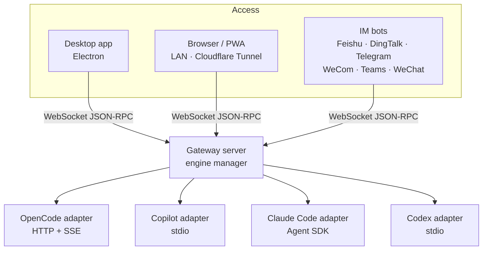

# CodeMux

**One workbench for Claude Code, Copilot CLI, OpenCode and Codex — on your desktop, in any browser, or from your chat app.**

**English** | [简体中文](./README.zh-CN.md) | [日本語](./README.ja.md) | [한국어](./README.ko.md) | [Русский](./README.ru.md)

[Website](https://realduang.github.io/codemux/) · [Download](https://github.com/realDuang/codemux/releases/latest) · [Docs](#-documentation) · [Roadmap](https://github.com/realDuang/codemux/discussions/61)

<!--
  TODO(demo-gif): replace the screenshot below with a 15–25 s GIF/MP4 (≤ 10 MB, ~1600px wide):
  pick an engine → send a prompt → expand a tool step with a diff → open the same session on a phone.
  Save as assets/screenshots/demo.gif and point this  at it.
-->

## What is CodeMux?

CodeMux is an open-source desktop and web client for **coding agents**. It does not wrap a model API. It talks to each agent's own runtime at the protocol level, so Claude Code, GitHub Copilot CLI, OpenCode and Codex keep their tools, sessions and project context, and you get one interface on top of all of them.

Then it lets you **leave your desk**. The same sessions, with every tool call, diff and shell command rendered live, are reachable from your phone's browser or from Feishu, DingTalk, Telegram, WeCom, Teams or WeChat, with no port forwarding.

- 🔀 **Multi-engine, not multi-model**: four real agent runtimes behind one UI, switchable per session.
- 👀 **See the whole chain of thought**: every tool call, file diff and command is an expandable step, not a wall of text.
- 📱 **Remote by default**: LAN QR code or one-click Cloudflare Tunnel, with device approval and per-device tokens.
- 💬 **Agents in your chat app**: streaming, structured replies in six IM platforms.
- 🧰 **A real workbench**: integrated terminal, file explorer, git worktrees, scheduled tasks, slash commands and skills.

> 💡 CodeMux is the **first open-source GUI for GitHub Copilot CLI**, connecting over JSON-RPC to deliver Copilot's full agentic experience visually.

## 🚀 Install

| Platform | Get it |
|----------|--------|
| **macOS** | `brew tap realDuang/codemux && brew install --cask codemux`, or the `.dmg` from [Releases](https://github.com/realDuang/codemux/releases/latest) (Apple Silicon: `-arm64.dmg`) |
| **Windows** | `CodeMux-Setup-<version>.exe` from [Releases](https://github.com/realDuang/codemux/releases/latest) |
| **Linux desktop** | `.AppImage` or `.deb` from [Releases](https://github.com/realDuang/codemux/releases/latest) |
| **Linux server (headless)** | Run the Node host and use it from any browser; see [Server runtime](docs/server-runtime.md) |
| **From source** | See [Development](docs/development.md) |

> ⚠️ The macOS build is not code-signed. If macOS says "App is damaged", run `xattr -cr /Applications/CodeMux.app`.

### Then connect an engine

CodeMux detects installed engines on startup. You need at least one:

| Engine | Protocol | Status | Setup |
|--------|----------|--------|-------|
| **[Claude Code](https://docs.anthropic.com/en/docs/claude-code)** | Claude Agent SDK | ✅ Stable | Runtime is bundled. Uses your existing Claude Code login or `ANTHROPIC_API_KEY`. |
| **[GitHub Copilot CLI](https://docs.github.com/en/copilot/concepts/agents/about-copilot-cli)** | JSON-RPC / stdio | ✅ Stable | Install Copilot CLI and sign in. |
| **[OpenCode](https://opencode.ai)** | HTTP REST + SSE | ✅ Stable | `curl -fsSL https://opencode.ai/install \| bash` (Windows: `irm https://opencode.ai/install.ps1 \| iex`) |
| **[Codex](https://github.com/openai/codex)** | JSON-RPC / stdio app-server | ⚠️ Experimental | Install the `codex` CLI; CodeMux reuses its login or API key. |

### Open it from your phone

1. Open **Remote Access** in CodeMux.
2. Pick **LAN** (scan the QR code) or **Cloudflare Tunnel** (works from anywhere, no account needed for quick tunnels).
3. Approve the new device with its 6-digit code. Done.

## ✨ Features

### Agent chain of thought, rendered

Every agent action is an expandable step: file diffs with syntax highlighting, shell commands with live output, searches, tool calls, todo lists and permission prompts. You see what the agent is doing and why, not only the final answer, and the same rendering follows you to the browser and to IM.

### A workbench, not a chat box

| | |
|---|---|
| **Integrated terminal** | VS Code-style tabs with real shells (`` Ctrl+` ``), search, clickable paths, and remote use over LAN or tunnel. |
| **File explorer & git changes** | Project tree, syntax-highlighted preview, live "Changes" tab with line counts and inline diffs. |
| **Git worktree sessions** | Work on several branches in parallel, each with its own sessions; merge back with merge, squash or rebase. |
| **Scheduled tasks** | Run agent tasks manually, every 5 min–12 h, daily or weekly, with missed-run catch-up. |
| **Slash commands & skills** | Type `/` for engine-native commands and skills with autocomplete. |
| **Agent modes & models** | Build / Plan / Autopilot modes and a separate model per engine. |
| **Approvals & questions** | Approve shell or edit operations inline ("always allow" for trusted patterns); answer agent questions with choices. |
| **Images in prompts** | Paste, drag or pick up to 4 images per message; all engines can read them. |
| **Token usage** | Input, output and cache tokens with per-engine cost breakdown. |

<table>
  <tr>
    <td></td>
    <td></td>
  </tr>
  <tr>
    <td align="center">Integrated terminal</td>
    <td align="center">File explorer and git changes</td>
  </tr>
</table>

### Remote access that keeps the full experience

| Method | Best for |
|--------|----------|
| **LAN browser** | Another device on the same network; IP and QR code detected automatically. |
| **Cloudflare Tunnel** | Anywhere, with no port forwarding or VPN. Quick tunnels need zero config; named tunnels keep [your own domain](docs/custom-access.md#cloudflare-custom-domains). |
| **Custom address** | Your own reverse proxy or route; see [Custom access](docs/custom-access.md). |
| **Installable PWA** | Add CodeMux to a phone's home screen over a stable HTTPS address; see [Web and mobile PWA](docs/web-pwa.md). |

New devices must be approved with a 6-digit code, each device gets its own JWT, and public tunnels use HTTPS. You can rename or revoke any device from the Devices page.

<table>
  <tr>
    <td></td>
    <td></td>
  </tr>
  <tr>
    <td align="center">Remote access</td>
    <td align="center">Device management</td>
  </tr>
</table>

<!--
  TODO(mobile-screenshot): add a phone screenshot (portrait, browser or PWA) showing a running session
  with an expanded tool step, e.g. assets/screenshots/mobile.jpg, as a third cell above.
-->

> CodeMux is designed for personal use. Revoke devices you no longer use and turn the public tunnel off when you do not need it.

### Coding agents in your chat app

Talk to your agents from IM with streaming output and structured cards, not just plain text replies. Start in a private chat with the bot, pick a project and session, and use `/cancel`, `/status`, `/mode`, `/model`, `/history` and `/help`.

| Platform | Streaming | Session model | Rich content |
|----------|-----------|---------------|--------------|
| [Feishu / Lark](docs/channels/feishu/README.md) | ✅ Edit in place | One group = one session | Interactive cards |
| [DingTalk](docs/channels/dingtalk/README.md) | ✅ AI Card | One group = one session | ActionCard / Markdown |
| [Telegram](docs/channels/telegram/README.md) | ✅ Draft / edit | Private chat | MarkdownV2 + buttons |
| [WeCom](docs/channels/wecom/README.md) | Batch | One group = one session | Markdown / template card |
| [Microsoft Teams](docs/channels/teams/README.md) | ✅ Edit in place | Private chat | Adaptive Cards |
| [WeChat (iLink, personal account)](docs/channels/weixin-ilink/README.md) | Batch | Private chat | Plain text |

📖 [Channel setup guide](docs/channels/README.md)

<!--
  TODO(im-screenshot): add one IM screenshot (e.g. Feishu or Telegram) showing a streamed reply with a
  tool summary, e.g. assets/screenshots/im-channel.jpg.
-->

## How is this different?

| | CodeMux | Text-only chat bots | A single agent's own UI |
|---|---|---|---|
| Real agent runtimes (tools, sessions, project context) | ✅ | ⚠️ Usually a model API | ✅ |
| Several agents in one place | ✅ Claude Code, Copilot, OpenCode, Codex | ❌ | ❌ |
| Tool calls, diffs and shell output rendered as steps | ✅ | ❌ Final text | ✅ Locally |
| Same experience from phone browser and IM | ✅ | ⚠️ Text only | ❌ |
| Self-hosted, your machine, your credentials | ✅ | Varies | ✅ |

## Architecture

All clients connect through the same gateway, and every engine is translated into one **normalized type system**, so tool calls, diffs and streaming messages look the same whichever engine or client you use.

## 📚 Documentation

| Topic | Doc |
|-------|-----|
| IM channel setup | [docs/channels](docs/channels/README.md) |
| Custom domains and access | [docs/custom-access.md](docs/custom-access.md) |
| Web and mobile PWA | [docs/web-pwa.md](docs/web-pwa.md) |
| Headless Linux server | [docs/server-runtime.md](docs/server-runtime.md) |
| Sharing chats with Codex Desktop | [docs/codex-desktop-sharing.md](docs/codex-desktop-sharing.md) |
| Development, commands, isolated dev | [docs/development.md](docs/development.md) |
| Project structure | [docs/project-structure.md](docs/project-structure.md) |

## 🤝 Contributing

Issues, ideas and pull requests are welcome. Start with [CONTRIBUTING.md](CONTRIBUTING.md), check the [Roadmap](https://github.com/realDuang/codemux/discussions/61), and ask anything in [Discussions](https://github.com/realDuang/codemux/discussions). Want another engine? See [Adding a new engine](docs/development.md#adding-a-new-engine).

If CodeMux is useful to you, a ⭐ helps other people find it.

## License

[MIT](LICENSE)

**Built with [Electron](https://electronjs.org), [SolidJS](https://solidjs.com), and a love for AI-assisted coding.**

