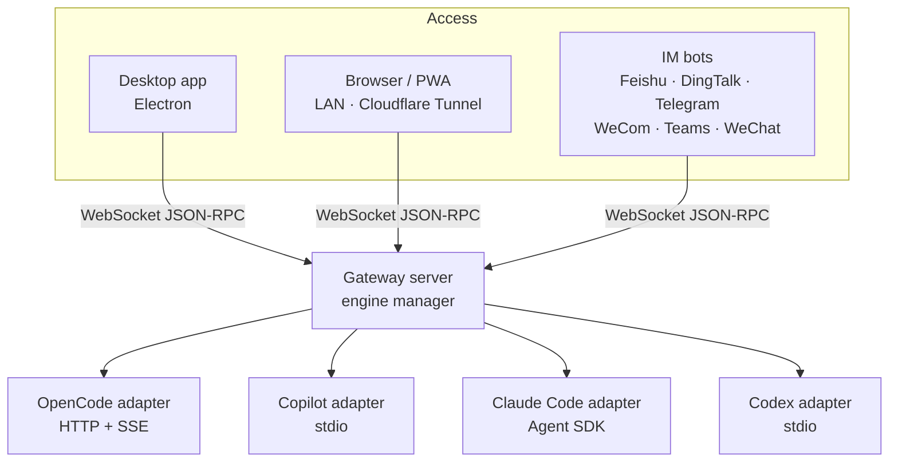

# CodeMux

**Один верстак для Claude Code, Copilot CLI, OpenCode и Codex: на десктопе, в любом браузере или прямо из мессенджера.**

[English](./README.md) | [简体中文](./README.zh-CN.md) | [日本語](./README.ja.md) | [한국어](./README.ko.md) | **Русский**

[Сайт](https://realduang.github.io/codemux/) · [Скачать](https://github.com/realDuang/codemux/releases/latest) · [Документация](#-документация) · [Дорожная карта](https://github.com/realDuang/codemux/discussions/61)

## Что такое CodeMux?

CodeMux — это открытый десктопный и веб-клиент для **агентов программирования**. Он не оборачивает API модели, а общается с собственной средой выполнения каждого агента на уровне протокола. Поэтому Claude Code, GitHub Copilot CLI, OpenCode и Codex сохраняют свои инструменты, сессии и контекст проекта, а вы получаете один интерфейс поверх всех них.

А ещё он позволяет **отойти от рабочего места**. Те же сессии, где каждый вызов инструмента, diff и команда оболочки отображаются в реальном времени, доступны из браузера телефона или из Feishu, DingTalk, Telegram, WeCom, Teams и WeChat, без проброса портов.

- 🔀 **Много движков, а не много моделей**: четыре настоящие среды агентов в одном интерфейсе, переключение для каждой сессии.
- 👀 **Вся цепочка рассуждений на виду**: каждый вызов инструмента, diff файла и команда — раскрываемый шаг, а не стена текста.
- 📱 **Удалённый доступ из коробки**: QR-код в локальной сети или Cloudflare Tunnel в один клик, с подтверждением устройств и токеном для каждого из них.
- 💬 **Агенты в мессенджере**: потоковые структурированные ответы на шести IM-платформах.
- 🧰 **Настоящий верстак**: встроенный терминал, обозреватель файлов, git worktree, задачи по расписанию, слэш-команды и навыки.

> 💡 CodeMux — **первый open-source GUI для GitHub Copilot CLI**: он подключается по JSON-RPC и даёт полноценный агентный опыт Copilot в визуальном интерфейсе.

## 🚀 Установка

| Платформа | Как получить |
|----------|--------|
| **macOS** | `brew tap realDuang/codemux && brew install --cask codemux` или `.dmg` из [Releases](https://github.com/realDuang/codemux/releases/latest) (Apple Silicon: `-arm64.dmg`) |
| **Windows** | `CodeMux-Setup-<version>.exe` из [Releases](https://github.com/realDuang/codemux/releases/latest) |
| **Linux (десктоп)** | `.AppImage` или `.deb` из [Releases](https://github.com/realDuang/codemux/releases/latest) |
| **Linux-сервер (без GUI)** | Запустите Node-хост и работайте из любого браузера; см. [Server runtime](docs/server-runtime.md) |
| **Из исходников** | См. [Development](docs/development.md) |

> ⚠️ Сборка для macOS не подписана. Если macOS пишет, что «приложение повреждено», выполните `xattr -cr /Applications/CodeMux.app`.

### Подключите движок

CodeMux находит установленные движки при запуске. Нужен хотя бы один:

| Движок | Протокол | Статус | Настройка |
|--------|----------|--------|-------|
| **[Claude Code](https://docs.anthropic.com/en/docs/claude-code)** | Claude Agent SDK | ✅ Стабильный | Среда выполнения встроена. Использует ваш вход в Claude Code или `ANTHROPIC_API_KEY`. |
| **[GitHub Copilot CLI](https://docs.github.com/en/copilot/concepts/agents/about-copilot-cli)** | JSON-RPC / stdio | ✅ Стабильный | Установите Copilot CLI и войдите. |
| **[OpenCode](https://opencode.ai)** | HTTP REST + SSE | ✅ Стабильный | `curl -fsSL https://opencode.ai/install \| bash` (Windows: `irm https://opencode.ai/install.ps1 \| iex`) |
| **[Codex](https://github.com/openai/codex)** | JSON-RPC / stdio app-server | ⚠️ Экспериментальный | Установите CLI `codex`; CodeMux использует его вход или API-ключ. |

### Откройте с телефона

1. Откройте **Remote Access** в CodeMux.
2. Выберите **Свой адрес** и сохраните LAN-адрес этого компьютера (например, `http://192.168.1.20:8233`) или выберите **Cloudflare Tunnel**, чтобы подключаться откуда угодно (для быстрых туннелей аккаунт не нужен). Включите удалённый доступ и отсканируйте QR-код.
3. Подтвердите новое устройство 6-значным кодом. Готово.

## ✨ Возможности

### Цепочка рассуждений агента — наглядно

Каждое действие агента — раскрываемый шаг: diff файлов с подсветкой синтаксиса, команды оболочки с живым выводом, поиск, вызовы инструментов, списки задач и запросы разрешений. Вы видите, что и зачем делает агент, а не только итоговый ответ, и то же отображение доступно в браузере и в мессенджере.

### Верстак, а не окно чата

| | |
|---|---|
| **Встроенный терминал** | Вкладки в стиле VS Code с настоящими оболочками (`` Ctrl+` ``), поиск, кликабельные пути, работа удалённо через LAN или туннель. |
| **Обозреватель файлов и изменения git** | Дерево проекта, предпросмотр с подсветкой, вкладка «Changes» в реальном времени со счётчиками строк и встроенными diff. |
| **Сессии в git worktree** | Параллельная работа в нескольких ветках, у каждой свои сессии; слияние через merge, squash или rebase. |
| **Задачи по расписанию** | Запуск задач агента вручную, каждые 5 мин–12 ч, ежедневно или еженедельно, с повторным запуском пропущенных выполнений. |
| **Слэш-команды и навыки** | Введите `/`, чтобы вызвать родные команды и навыки движка с автодополнением. |
| **Режимы агента и модели** | Режимы Build / Plan / Autopilot и отдельная модель для каждого движка. |
| **Подтверждения и вопросы** | Подтверждайте команды оболочки и правки прямо в чате («всегда разрешать» для доверенных шаблонов); отвечайте на вопросы агента с вариантами. |
| **Изображения в запросах** | Вставка, перетаскивание или выбор до 4 изображений на сообщение; их понимают все движки. |
| **Расход токенов** | Входные, выходные и кэшированные токены с разбивкой стоимости по движкам. |

<table>
  <tr>
    <td></td>
    <td></td>
  </tr>
  <tr>
    <td align="center">Встроенный терминал</td>
    <td align="center">Изменения git со встроенным diff</td>
  </tr>
  <tr>
    <td></td>
    <td></td>
  </tr>
  <tr>
    <td align="center">Задачи по расписанию</td>
    <td align="center">Обозреватель и предпросмотр файлов</td>
  </tr>
</table>

### Удалённый доступ без потери возможностей

| Способ | Когда подходит |
|--------|----------|
| **Браузер в LAN** | Другое устройство в той же сети: сохраните LAN-IP и порт этого компьютера как свой адрес и отсканируйте QR-код. |
| **Cloudflare Tunnel** | Откуда угодно, без проброса портов и VPN. Быстрые туннели не требуют настройки; именованные сохраняют [ваш домен](docs/custom-access.md#cloudflare-custom-domains). |
| **Свой адрес** | Ваш собственный обратный прокси или маршрут; см. [Custom access](docs/custom-access.md). |
| **Устанавливаемое PWA** | Добавьте CodeMux на домашний экран телефона по стабильному HTTPS-адресу; см. [Web and mobile PWA](docs/web-pwa.md). |

Новые устройства подтверждаются 6-значным кодом, каждое получает собственный JWT, а публичные туннели используют HTTPS. На странице устройств можно переименовать или отозвать любое устройство.

<table>
  <tr>
    <td></td>
    <td></td>
    <td width="22%"></td>
  </tr>
  <tr>
    <td align="center">Удалённый доступ</td>
    <td align="center">Управление устройствами</td>
    <td align="center">Та же сессия на телефоне</td>
  </tr>
</table>

> CodeMux рассчитан на личное использование. Отзывайте устройства, которыми больше не пользуетесь, и выключайте публичный туннель, когда он не нужен.

### Агенты программирования в мессенджере

Общайтесь с агентами из мессенджера и получайте потоковый вывод и структурированные карточки, а не только обычный текст. Начните с личного чата с ботом, выберите проект и сессию и используйте `/cancel`, `/status`, `/mode`, `/model`, `/history` и `/help`.

| Платформа | Потоковый вывод | Модель сессий | Расширенный контент |
|----------|-----------|---------------|--------------|
| [Feishu / Lark](docs/channels/feishu/README.md) | ✅ Правка на месте | Одна группа = одна сессия | Интерактивные карточки |
| [DingTalk](docs/channels/dingtalk/README.md) | ✅ AI Card | Одна группа = одна сессия | ActionCard / Markdown |
| [Telegram](docs/channels/telegram/README.md) | ✅ Черновик / правка | Личный чат | MarkdownV2 + кнопки |
| [WeCom](docs/channels/wecom/README.md) | Пакетно | Одна группа = одна сессия | Markdown / шаблонные карточки |
| [Microsoft Teams](docs/channels/teams/README.md) | ✅ Правка на месте | Личный чат | Adaptive Cards |
| [WeChat (iLink, личный аккаунт)](docs/channels/weixin-ilink/README.md) | Пакетно | Личный чат | Обычный текст |

📖 [Руководство по настройке каналов](docs/channels/README.md)

## Чем это отличается?

| | CodeMux | Текстовые чат-боты | Собственный UI одного агента |
|---|---|---|---|
| Настоящие среды агентов (инструменты, сессии, контекст проекта) | ✅ | ⚠️ Обычно API модели | ✅ |
| Несколько агентов в одном месте | ✅ Claude Code, Copilot, OpenCode, Codex | ❌ | ❌ |
| Вызовы инструментов, diff и вывод оболочки в виде шагов | ✅ | ❌ Только итоговый текст | ✅ Только локально |
| Тот же опыт в браузере телефона и в мессенджере | ✅ | ⚠️ Только текст | ❌ |
| Self-hosted: ваша машина, ваши учётные данные | ✅ | По-разному | ✅ |

## Архитектура

Все клиенты подключаются через один и тот же шлюз, а каждый движок переводится в единую **нормализованную систему типов**, поэтому вызовы инструментов, diff и потоковые сообщения выглядят одинаково, какой бы движок или клиент вы ни использовали.

## 📚 Документация

| Тема | Документ |
|-------|-----|
| Настройка IM-каналов | [docs/channels](docs/channels/README.md) |
| Свои домены и доступ | [docs/custom-access.md](docs/custom-access.md) |
| Веб и мобильное PWA | [docs/web-pwa.md](docs/web-pwa.md) |
| Linux-сервер без GUI | [docs/server-runtime.md](docs/server-runtime.md) |
| Общие чаты с Codex Desktop | [docs/codex-desktop-sharing.md](docs/codex-desktop-sharing.md) |
| Разработка, команды, изолированные экземпляры | [docs/development.md](docs/development.md) |
| Структура проекта | [docs/project-structure.md](docs/project-structure.md) |

Документация написана на английском языке.

## 🤝 Участие в проекте

Будем рады issue, идеям и pull request. Начните с [CONTRIBUTING.md](CONTRIBUTING.md), загляните в [дорожную карту](https://github.com/realDuang/codemux/discussions/61) и задавайте вопросы в [Discussions](https://github.com/realDuang/codemux/discussions). Хотите добавить ещё один движок? См. [Adding a new engine](docs/development.md#adding-a-new-engine).

Если CodeMux вам полезен, ⭐ поможет другим людям его найти.

## Лицензия

[MIT](LICENSE)

**Создано на [Electron](https://electronjs.org), [SolidJS](https://solidjs.com) и с любовью к программированию вместе с ИИ.**

