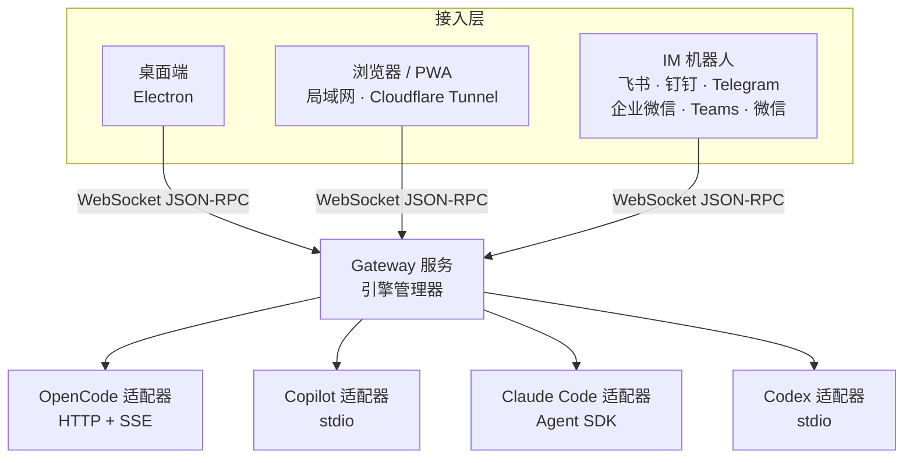

# CodeMux

**一个工作台，同时驾驭 Claude Code、Copilot CLI、OpenCode 和 Codex：桌面端、任意浏览器、或直接在聊天软件里。**

[English](./README.md) | **简体中文** | [日本語](./README.ja.md) | [한국어](./README.ko.md) | [Русский](./README.ru.md)

[官网](https://realduang.github.io/codemux/) · [下载](https://github.com/realDuang/codemux/releases/latest) · [文档](#-文档) · [路线图](https://github.com/realDuang/codemux/discussions/61)

## CodeMux 是什么？

CodeMux 是一个面向**编程 Agent** 的开源桌面端与 Web 客户端。它不是对模型 API 的封装，而是在协议层直接对接每个 Agent 自己的运行时，所以 Claude Code、GitHub Copilot CLI、OpenCode 和 Codex 的工具、会话和项目上下文都完整保留，你只是多了一个统一的界面。

然后，它让你可以**离开工位**。同样的会话，连同每一次工具调用、文件 diff 和 Shell 命令的实时渲染，都能在手机浏览器里打开，或者在飞书、钉钉、Telegram、企业微信、Teams、微信里直接使用，无需端口转发。

- 🔀 **多引擎，而非多模型**：四个真正的 Agent 运行时，同一个界面，按会话切换。
- 👀 **完整的思维链**：每次工具调用、文件 diff、命令执行都是可展开的步骤，而不是一大段文字。
- 📱 **天生支持远程**：局域网扫码，或一键 Cloudflare Tunnel，带设备审批和独立设备令牌。
- 💬 **聊天软件里的 Agent**：六个 IM 平台，流式输出、结构化回复。
- 🧰 **真正的工作台**：内置终端、文件浏览器、Git worktree、定时任务、斜杠命令与技能。

> 💡 CodeMux 是 **首个 GitHub Copilot CLI 开源图形界面**，通过 JSON-RPC 在协议层对接，可视化呈现 Copilot 完整的 Agent 编程体验。

## 🚀 安装

| 平台 | 获取方式 |
|------|----------|
| **macOS** | `brew tap realDuang/codemux && brew install --cask codemux`，或从 [Releases](https://github.com/realDuang/codemux/releases/latest) 下载 `.dmg`（Apple Silicon 选 `-arm64.dmg`） |
| **Windows** | 从 [Releases](https://github.com/realDuang/codemux/releases/latest) 下载 `CodeMux-Setup-<版本>.exe` |
| **Linux 桌面** | 从 [Releases](https://github.com/realDuang/codemux/releases/latest) 下载 `.AppImage` 或 `.deb` |
| **Linux 服务器（无界面）** | 运行 Node 主机，用任意浏览器访问，见 [Server runtime](docs/server-runtime.md) |
| **源码运行** | 见 [Development](docs/development.md) |

> ⚠️ macOS 版本未签名。如果提示"应用已损坏"，请执行 `xattr -cr /Applications/CodeMux.app`。

### 接入一个引擎

CodeMux 启动时会自动检测已安装的引擎，至少需要一个：

| 引擎 | 协议 | 状态 | 准备工作 |
|------|------|------|----------|
| **[Claude Code](https://docs.anthropic.com/en/docs/claude-code)** | Claude Agent SDK | ✅ 稳定 | 运行时已内置，沿用你现有的 Claude Code 登录或 `ANTHROPIC_API_KEY`。 |
| **[GitHub Copilot CLI](https://docs.github.com/en/copilot/concepts/agents/about-copilot-cli)** | JSON-RPC / stdio | ✅ 稳定 | 安装 Copilot CLI 并登录。 |
| **[OpenCode](https://opencode.ai)** | HTTP REST + SSE | ✅ 稳定 | `curl -fsSL https://opencode.ai/install \| bash`（Windows：`irm https://opencode.ai/install.ps1 \| iex`） |
| **[Codex](https://github.com/openai/codex)** | JSON-RPC / stdio app-server | ⚠️ 实验性 | 安装 `codex` CLI，CodeMux 复用它的登录或 API Key。 |

### 用手机打开

1. 在 CodeMux 中打开**远程访问**。
2. 选择**自定义**并保存这台电脑的局域网地址（例如 `http://192.168.1.20:8233`），或选择 **Cloudflare Tunnel** 以便随处访问（快速隧道无需账号）。开启远程访问后扫描二维码。
3. 用 6 位验证码批准新设备，完成。

## ✨ 功能

### 完整呈现 Agent 思维链

Agent 的每个动作都是一个可展开的步骤：带语法高亮的文件 diff、实时输出的 Shell 命令、搜索、工具调用、待办列表和权限请求。你能看到 Agent 在做什么、为什么这么做，而不只是最终答案；同样的渲染在浏览器和 IM 中也一样。

### 是工作台，不是聊天框

| | |
|---|---|
| **内置终端** | VS Code 风格多标签真实 Shell（`` Ctrl+` ``），支持搜索、可点击路径，局域网和隧道远程同样可用。 |
| **文件浏览器与 Git 变更** | 项目文件树、语法高亮预览，实时"变更"标签页显示增删行数与内联 diff。 |
| **Git worktree 并行会话** | 多个分支并行开发，各自拥有独立会话；可选 merge、squash 或 rebase 合并回去。 |
| **定时任务** | 手动触发、每 5 分钟到 12 小时、每天或每周执行 Agent 任务，应用重启后补跑错过的任务。 |
| **斜杠命令与技能** | 输入 `/` 调用引擎原生命令和技能，带自动补全。 |
| **Agent 模式与模型** | Build / Plan / Autopilot 模式，每个引擎独立选择模型。 |
| **权限审批与问答** | 内联批准 Shell 或文件编辑操作（可对信任的模式"始终允许"），并回答 Agent 提出的选择题。 |
| **图片输入** | 粘贴、拖拽或选择，每条消息最多 4 张图片，所有引擎都能识别。 |
| **Token 用量** | 输入、输出、缓存 Token 统计，按引擎拆分费用。 |

<table>
  <tr>
    <td></td>
    <td></td>
  </tr>
  <tr>
    <td align="center">内置终端</td>
    <td align="center">Git 变更与内联 diff</td>
  </tr>
  <tr>
    <td></td>
    <td></td>
  </tr>
  <tr>
    <td align="center">定时任务</td>
    <td align="center">文件浏览与预览</td>
  </tr>
</table>

### 远程访问，体验不打折

| 方式 | 适用场景 |
|------|----------|
| **局域网浏览器** | 同一网络下的其他设备：把这台电脑的局域网 IP 和端口保存为自定义地址，然后扫码访问。 |
| **Cloudflare Tunnel** | 随时随地访问，无需端口转发或 VPN。快速隧道零配置；命名隧道可绑定[自己的域名](docs/custom-access.md#cloudflare-custom-domains)。 |
| **自定义地址** | 使用你自己的反向代理或路由，见 [Custom access](docs/custom-access.md)。 |
| **可安装的 PWA** | 通过固定的 HTTPS 地址把 CodeMux 添加到手机主屏，见 [Web and mobile PWA](docs/web-pwa.md)。 |

新设备需要通过 6 位验证码批准，每台设备拥有独立的 JWT，公网隧道全程 HTTPS。你可以在设备管理页重命名或撤销任意设备。

<table>
  <tr>
    <td></td>
    <td></td>
    <td width="22%"></td>
  </tr>
  <tr>
    <td align="center">远程访问</td>
    <td align="center">设备管理</td>
    <td align="center">手机上的同一会话</td>
  </tr>
</table>

> CodeMux 面向个人使用。不再使用的设备请及时撤销，不需要时请关闭公网隧道。

### 在聊天软件里使用编程 Agent

在 IM 中与 Agent 对话，获得流式输出和结构化卡片，而不只是纯文本。先私聊机器人选择项目和会话，然后可使用 `/cancel`、`/status`、`/mode`、`/model`、`/history`、`/help`。

| 平台 | 流式输出 | 会话模型 | 富文本 |
|------|----------|----------|--------|
| [飞书 / Lark](docs/channels/feishu/README.md) | ✅ 原地更新 | 一个群 = 一个会话 | 交互卡片 |
| [钉钉](docs/channels/dingtalk/README.md) | ✅ AI 卡片 | 一个群 = 一个会话 | ActionCard / Markdown |
| [Telegram](docs/channels/telegram/README.md) | ✅ 草稿 / 编辑 | 私聊 | MarkdownV2 + 按钮 |
| [企业微信](docs/channels/wecom/README.md) | 批量发送 | 一个群 = 一个会话 | Markdown / 模板卡片 |
| [Microsoft Teams](docs/channels/teams/README.md) | ✅ 原地更新 | 私聊 | Adaptive Cards |
| [微信（iLink 个人号）](docs/channels/weixin-ilink/README.md) | 批量发送 | 私聊 | 纯文本 |

📖 [渠道配置指南](docs/channels/README.md)

## 有什么不同？

| | CodeMux | 纯文本聊天机器人 | 单个 Agent 自带的界面 |
|---|---|---|---|
| 真正的 Agent 运行时（工具、会话、项目上下文） | ✅ | ⚠️ 通常只是模型 API | ✅ |
| 多个 Agent 集中在一处 | ✅ Claude Code、Copilot、OpenCode、Codex | ❌ | ❌ |
| 工具调用、diff、Shell 输出按步骤渲染 | ✅ | ❌ 只有最终文本 | ✅ 仅本地 |
| 手机浏览器和 IM 中体验一致 | ✅ | ⚠️ 仅文本 | ❌ |
| 自托管：你的机器、你的凭据 | ✅ | 视情况而定 | ✅ |

## 架构

所有客户端都通过同一个 Gateway 连接，每个引擎都被转换为统一的**标准化类型系统**，因此无论使用哪个引擎、哪种客户端，工具调用、diff 和流式消息的呈现都完全一致。

## 📚 文档

| 主题 | 文档 |
|------|------|
| IM 渠道配置 | [docs/channels](docs/channels/README.md) |
| 自定义域名与访问方式 | [docs/custom-access.md](docs/custom-access.md) |
| Web 与移动端 PWA | [docs/web-pwa.md](docs/web-pwa.md) |
| 无界面 Linux 服务器 | [docs/server-runtime.md](docs/server-runtime.md) |
| 与 Codex Desktop 共享会话 | [docs/codex-desktop-sharing.md](docs/codex-desktop-sharing.md) |
| 开发、命令、隔离开发实例 | [docs/development.md](docs/development.md) |
| 项目结构 | [docs/project-structure.md](docs/project-structure.md) |

## 🤝 参与贡献

欢迎提 Issue、想法和 PR。先看看 [CONTRIBUTING.md](CONTRIBUTING.md) 和 [路线图](https://github.com/realDuang/codemux/discussions/61)，有任何问题欢迎到 [Discussions](https://github.com/realDuang/codemux/discussions) 交流。想接入新的引擎？见 [Adding a new engine](docs/development.md#adding-a-new-engine)。

如果 CodeMux 对你有帮助，点个 ⭐ 能让更多人发现它。

## 许可证

[MIT](LICENSE)

**基于 [Electron](https://electronjs.org)、[SolidJS](https://solidjs.com) 构建，以及对 AI 辅助编程的热爱。**

